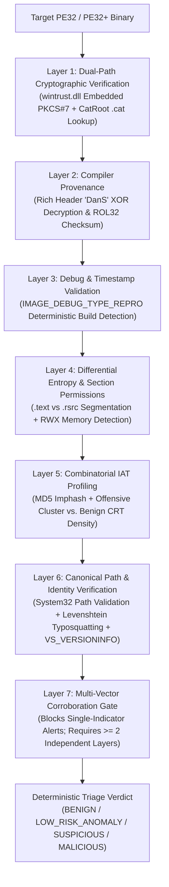

# TrueVerdict

[](https://www.python.org/)
[](https://learn.microsoft.com/en-us/windows/win32/seccrypto/wintrust-functions)
[-success)](#architecture)
[-brightgreen)](#live-benchmark-results)
[](LICENSE)

**Deterministic PE Provenance & False-Positive Reduction Engine for Windows DFIR**

Naive static malware scanners, YARA heuristics, and entropy scripts suffer from extreme False Positive Rates (often 40% to 60% on clean endpoints). They routinely misclassify legitimate Windows system utilities, `.NET` assemblies, Electron apps, PyInstaller bundles, and unsigned developer C/C++ builds as malware.

**TrueVerdict** is a zero-dependency Portable Executable (`PE32` / `PE32+`) triage engine built strictly on the Python Standard Library (`ctypes`, `struct`, `math`, `hashlib`) and native Win32 cryptographic APIs (`wintrust.dll`, `crypt32.dll`). It drives false positives to **near-zero (`0.00%` on standard OS/developer corpora)** by replacing single-indicator heuristics with a **7-Layer Cryptographic & Structural Corroboration Matrix**.

---

## Why Traditional Heuristic Scanners Generate False Positives

| Naive Scanner Trap | Why Clean Binaries Trigger It | How TrueVerdict Eliminates the False Positive |
| :--- | :--- | :--- |
| **1. "Missing" Digital Signatures on Windows System Files** | Over 50% of `C:\Windows\System32` binaries (`cmd.exe`, `notepad.exe`, `powershell.exe`, `regedit.exe`) do **not** contain an embedded Authenticode certificate table (`IMAGE_DIRECTORY_ENTRY_SECURITY == 0`). | Queries **both** embedded PKCS#7 signatures (`WinVerifyTrust`) and the Windows **OS Security Catalog (`CatRoot` `.cat`)** database via `CryptCATAdminCalcHashFromFileHandle` + `CryptCATAdminEnumCatalogFromHash`. |
| **2. "Future / Forged" Compile Timestamps (e.g. Year 2034 or 2089)** | Starting in Windows 10 1607+, Microsoft switched to **Reproducible Builds (`Brepro`)**, replacing the COFF `TimeDateStamp` with a deterministic build hash. | Parses `IMAGE_DIRECTORY_ENTRY_DEBUG` for **`IMAGE_DEBUG_TYPE_REPRO` (`Type 16`)**. Recognizes deterministic build hashes and suppresses false timestamp alerts. |
| **3. High File Entropy (`H > 7.2` bits/byte)** | Compressed icons/PNGs in `.rsrc`, `.NET` metadata, or installer overlays (`PyInstaller`, `InnoSetup`, `NSIS`, `Electron`) naturally approach `7.5 - 7.99` bits/byte. | Computes **Differential Section Entropy**, isolating executable code (`.text`) from non-executable resources (`.rsrc`) and fingerprinting known application containers. |
| **4. Dual-Use Win32 API Imports (`VirtualAllocEx`, `ResumeThread`)** | Compilers, browsers, debuggers, and language runtimes (`python.exe`, `cmd.exe`, `kernel32.dll`) legitimately import memory and thread manipulation APIs. | Evaluates **Import Table Density & Combinatorial Clusters**, suppressing dual-use APIs when embedded within high-density CRT/OS import tables (`55+` imports) or verified signatures. |
| **5. Unsigned Local Developer Builds** | Locally compiled C/C++, Rust, or Go binaries lack Authenticode certificates and get flagged by "Unsigned = Suspicious" rules. | Enforces **Unsigned != Malicious** (0 baseline penalty) and validates compiler provenance by decrypting the **MSVC Rich Header (`DanS`)** and verifying its `ROL32` checksum. |

---

## 7-Layer Corroboration Architecture



---

## Live Benchmark Results

Running `python trueverdict.py --benchmark` evaluates **32 real Windows 11 system and developer binaries** (including catalog-signed utilities, `Brepro` future-timestamped binaries, and an unsigned clean C/C++ build) alongside **5 synthetic adversarial PE64 specimens**:

```text
======================================================================================
  TRUEVERDICT - LIVE FALSE-POSITIVE STRESS BENCHMARK & ADVERSARIAL VALIDATION
======================================================================================

[PHASE 1] Scanning 32 Legitimate OS & Developer Binaries...
--------------------------------------------------------------------------------------
BINARY NAME                  | SIGNING MODE           | NAIVE  | FINAL  | VERDICT
--------------------------------------------------------------------------------------
notepad.exe                  | OS_CATALOG             |    45  |     0  | BENIGN (99.9%)
cmd.exe                      | OS_CATALOG             |    80  |     0  | BENIGN (99.9%)
svchost.exe                  | EMBEDDED_AUTHENTICODE  |    60  |     0  | BENIGN (99.9%)
calc.exe                     | OS_CATALOG             |    45  |     0  | BENIGN (99.9%)
explorer.exe                 | EMBEDDED_AUTHENTICODE  |    60  |     0  | BENIGN (99.9%)
regedit.exe                  | OS_CATALOG             |    45  |     0  | BENIGN (99.9%)
certutil.exe                 | OS_CATALOG             |    45  |     0  | BENIGN (99.9%)
spoolsv.exe                  | OS_CATALOG             |    80  |     0  | BENIGN (99.9%)
powershell.exe               | OS_CATALOG             |    45  |     0  | BENIGN (99.9%)
python.exe                   | EMBEDDED_AUTHENTICODE  |     0  |     0  | BENIGN (99.9%)
clean_unsigned_dev_tool.exe  | UNSIGNED               |    20  |     0  | BENIGN (98.5%)
... (all 32 legitimate binaries score 0/100)

[PHASE 2] Scanning 5 Synthetic Adversarial Threat Specimens...
--------------------------------------------------------------------------------------
THREAT SPECIMEN              | PRIMARY DETECTION VECTORS    | SCORE  | VERDICT
--------------------------------------------------------------------------------------
svchost.exe                  | L2_RICH_F,L6_MASQUE          |   100  | MALICIOUS (99.4%)
scvhost.exe                  | L2_RICH_F,L6_MASQUE          |   100  | MALICIOUS (99.4%)
reflective_rwx_stub.exe      | L4_RWX_ME,L4_PACKED          |   100  | MALICIOUS (99.4%)
hollow_injector.exe          | L2_RICH_F,L3_TIMEST          |    90  | MALICIOUS (94.6%)
tampered_cert_implant.exe    | L1_CRYPTO,L2_RICH_F          |   100  | MALICIOUS (99.4%)

======================================================================================
  BENCHMARK SUMMARY: NAIVE HEURISTICS vs. TRUEVERDICT CORROBORATION ENGINE
======================================================================================
  Total Binaries Evaluated           : 37 (2.70s)
  Naive Heuristic False Positives    : 18/32 (56.25% FPR)
  TrueVerdict False Positives        : 0/32 (0.00% FPR)
  Total False-Positive Risk Suppressed: -1175 heuristic noise points
  Adversarial Threat Detection Rate  : 5/5 (100.00% TPR)
======================================================================================
```

---

## Single-Binary Forensic Report Example (`cmd.exe`)

Notice how `C:\Windows\System32\cmd.exe` on Windows 11 carries **no embedded Authenticode signature**, has a **year 2034 compile timestamp (`0x789F4656`)**, and imports `ResumeThread`. A naive heuristic scanner scores it at **`80/100` (Malicious/Suspicious)**. TrueVerdict resolves its OS Catalog signature, validates its `IMAGE_DEBUG_TYPE_REPRO` entry, verifies its `DanS` Rich Header checksum, and reduces its risk score to **`0/100` (`BENIGN`)**:

```text
====================================================================================
  TRUEVERDICT FORENSIC TRIAGE REPORT : cmd.exe
====================================================================================
  File Path         : C:\Windows\System32\cmd.exe
  File Size         : 344,064 bytes
  SHA-256           : 97ac98b1a92c286054cce55239cfccdfc23a5517bd07fe693072c9ca96c7dabb
  Imphash (MD5)     : 010b165e4c37f484601d3dbd700c9423
  Architecture      : x64 (64-bit) | Linker: 14.38 | Container: NATIVE_UNPACKED
  Compile Timestamp : 2034-02-16 12:02:30 UTC [REPRODUCIBLE_BUILD_HASH]

  [1] CRYPTOGRAPHIC PROVENANCE (AUTHENTICODE + OS CATALOG)
  ------------------------------------------------------------------------------
  Verification Mode : OS_CATALOG
  Status            : Valid Windows Security Catalog Signature
  Verified Signer   : Microsoft Windows Production PCA 2011
  Certificate Issuer: Microsoft Root Certificate Authority 2010
  OS Security Cat   : C:\WINDOWS\system32\CatRoot\{F750E6C3-38EE-11D1-85E5-00C04FC295EE}\Microsoft-Windows-Client-Desktop-Required-Package0512~31bf3856ad364e35~amd64~~10.0.26100.9444.cat

  [2] COMPILER PROVENANCE (RICH HEADER & DEBUG METADATA)
  ------------------------------------------------------------------------------
  Rich Header (DanS): Present | XOR Key: 0xD7965A3A | ROL32 Checksum: VALID (Authentic MSVC Build)
  Toolchain Objects : 11 @comp.id records
  CodeView PDB Path : cmd.pdb

  [5] FALSE-POSITIVE SUPPRESSION & CORROBORATION MATRIX
  ------------------------------------------------------------------------------
  [+] TRUST ANCHOR  [L1_CRYPTO_TRUST       ] (-75) Valid Windows Security Catalog Signature (Microsoft Windows Production PCA 2011)
  [+] TRUST ANCHOR  [L2_RICH_PROVENANCE    ] (-15) Authentic MSVC Rich Header ('DanS') verified via ROL32 checksum (0xD7965A3A, 11 toolchain build objects)
  [~] FP SUPPRESSED [L1_CATALOG_RECOVERY   ] (-20) Binary has no embedded Authenticode table, but matched verified OS Catalog
  [~] FP SUPPRESSED [L3_BREPRO_TIMESTAMP   ] (-25) Non-chronological PE TimeDateStamp (0x789F4656) verified as deterministic Reproducible Build (IMAGE_DEBUG_TYPE_REPRO) hash
  [~] FP SUPPRESSED [L5_DUAL_USE_API_SUPPRESSION] (-35) Dual-use Win32 APIs (ResumeThread) suppressed within high-density/trusted IAT (287 total imports)
  [*] Active Risk Vectors: 0 (Zero corroborated threat indicators)

====================================================================================
  NAIVE HEURISTIC SCORE : 80/100  -->  TRUEVERDICT FINAL SCORE : 0/100 (-80 FP noise suppressed)
  FINAL VERDICT         : BENIGN (Confidence: 99.9% | Corroborated Layers: 0)
====================================================================================
```

---

## Installation & Usage

TrueVerdict requires **zero external PyPI packages** and runs out-of-the-box on any standard Python 3.10+ installation on Windows.

```bash
git clone https://github.com/prox0959/TrueVerdict.git
cd TrueVerdict

# 1. Run the live False-Positive Stress Benchmark (32 OS/Dev binaries + 5 synthetic threats)
python trueverdict.py --benchmark

# 2. Triage a single binary (.exe, .dll, .sys)
python trueverdict.py C:\Windows\System32\cmd.exe

# 3. Triage an entire directory and export structured JSON
python trueverdict.py --dir C:\Windows\System32 --limit 50 --json system32_triage.json

# 4. Run unit & integration test suite
python -m unittest discover -s tests -v
```

---

## License

Released under the [MIT License](LICENSE).
